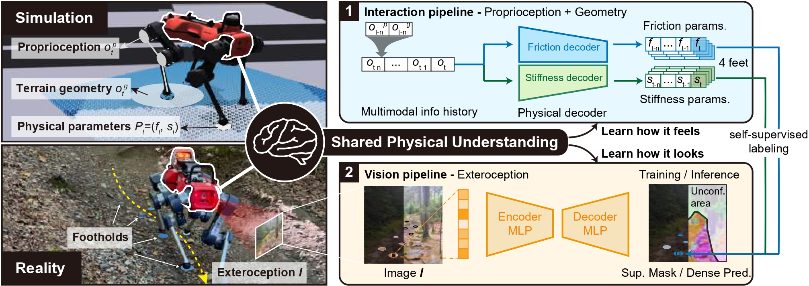
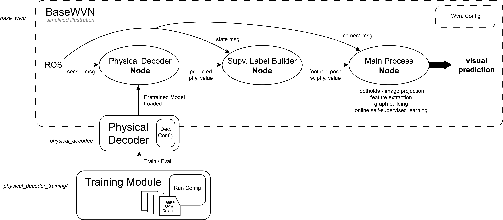

# 地形物理参数学习



本仓库是论文《Identifying Terrain Physical Parameters from Vision - Towards Physical-Parameter-Aware Locomotion and Navigation》（从视觉识别地形物理参数——迈向物理参数感知的运动控制与导航）的配套代码。更多信息请参见[项目主页](https://bit.ly/3Xo5AA8)。

本仓库主要包含三个部分：

1. 可独立使用的预训练物理解码器
2. 物理解码器训练模块
3. 自监督视觉解码器学习模块

**维护者**：Jiaqi Chen  
**所属机构**：苏黎世联邦理工学院（ETH Zurich）  
**联系方式**：chenjiaq@student.ethz.ch

如果本项目对您的研究有所帮助，欢迎引用以下论文。我们也欢迎反馈与合作：

```bibtex
@ARTICLE{Chen24physical,
  author={Chen, Jiaqi and Frey, Jonas and Zhou, Ruyi and Miki, Takahiro and Martius, Georg and Hutter, Marco},
  journal={IEEE Robotics and Automation Letters},
  title={Identifying Terrain Physical Parameters From Vision - Towards Physical-Parameter-Aware Locomotion and Navigation},
  year={2024},
  volume={9},
  number={11},
  pages={9279-9286},
  doi={10.1109/LRA.2024.3455788}}
```

## 代码结构概览



## 使用说明：物理解码器及其训练

**主要特点：**

- 无需专门用于地形参数估计的传感器。
- 能够以较小延迟，为每只脚提供合理的地形摩擦和刚度估计。
- 物理解码器的训练独立于运动控制策略的学习。

**注意事项：**

- 当前提供的代码和模型仅支持 **ANYmal D**。用于其他机器人或运动控制策略时，可能需要修改代码并重新训练。
- 在真实环境中部署时，预测结果可能存在噪声，摩擦估计通常比刚度估计噪声更大。建议将解码器输出理解为**相对指标**，而非绝对测量值。

## 1. 可独立使用的预训练物理解码器（目录：[physical_decoder](physical_decoder/)）

可以按照以下步骤使用预训练物理解码器。

### 安装

首先，将本仓库克隆到本地，然后进入相应目录并安装依赖和软件包：

```shell
cd physical_decoder/

# 安装依赖
pip install -r requirements.txt

# 以可编辑模式安装软件包
pip install -e .
```

### 工作原理

摩擦和刚度两个解码器均以序列数据为输入，输出对应的物理参数序列。部署时，取输出序列的最后一个时间步作为当前时刻的预测结果。

模型采用具有并行分支的 GRU + 自注意力（Self-Attention）结构。模型权重会从软件包目录中自动加载。

#### ⚠️ 重要：共享解码器配置

> 文件 [`physical_decoder/physical_decoder/decoder_config.py`](physical_decoder/physical_decoder/decoder_config.py) 是解码器配置的**唯一来源**。

以下两个模块共同使用此配置文件：

- `base_wvn`
- `physical_decoder_training`

修改任一模块中的解码器行为时，请务必在此文件中检查并调整配置。

### 使用示例

以下示例展示了部署时（例如在 ROS 中）调用解码器的方法。详细的 ROS 使用说明请参见 `base_wvn` 目录。

```python
from physical_decoder import DeploymentWrapper

# 初始化
physical_decoder = DeploymentWrapper()

# 主循环
while True:
    # 部署时，每个时间步的输入通常是形状为 (batch_size, feature_dim) 的观测张量
    fric_pred, stiff_pred = physical_decoder.predict(input_data)
    # 两个输出张量的形状均为 (batch_size, priv_size)，其中 priv_size = 4，对应四只脚
```

## 2. 物理解码器训练（目录：[physical_decoder_training](physical_decoder_training/)）

### 安装

```bash
cd physical_decoder_training
pip install -r requirements.txt
```

在 Shell 配置文件 `.bashrc` 中设置 Neptune API 令牌、用户名和项目名称：

```bash
export NEPTUNE_API_TOKEN="your_neptune_api_token"
export NEPTUNE_USERNAME="your_neptune_username"
export NEPTUNE_PROJECT="your_neptune_username/your_neptune_project_name"
```

### 训练与评估

1. 在 [`physical_decoder_training/training_utils/run_config.py`](physical_decoder_training/training_utils/run_config.py) 中配置运行参数，包括：
   - `mode`：设为 `'train'` 时执行训练与评估，设为 `'eval'` 时仅执行评估。
   - `train_data_directory`、`val_data_directory`：指定训练集和验证集的路径。
   - `max_epochs`、`batch_size` 等：根据需要调整。

2. 在 [`physical_decoder/physical_decoder/decoder_config.py`](physical_decoder/physical_decoder/decoder_config.py) 中配置解码器模型，包括：
   - `seq_length`：循环神经网络的输入序列长度。
   - `input_type`：选择输入特征类型，例如 `'pro'`、`'pro+exte'` 或 `'all'`。
   - `output_type`：输出参数类型，`'fric'` 表示摩擦，`'stiff'` 表示刚度。
   - `device`：设为 `'cuda'` 时使用 GPU 训练或推理，设为 `'cpu'` 时使用 CPU。
   - `hidden_size` 等模型结构参数。

3. 主训练与评估流程位于 `physical_decoder_training/train_eval.py`。

摩擦预测和刚度预测使用不同的数据集，并分别进行训练。训练不同解码器时，请修改解码器配置中的 `output_type`。具体实现请参见代码。

您可以使用我们预先采集的数据集进行训练：从[此链接](https://drive.google.com/drive/folders/1GiX66anCw4DuOGTlS3FzBez0hATTrJbL?usp=drive_link)下载 `dataset` 文件夹，并在配置文件中指定训练集和验证集的路径。

### 运行

在仓库根目录执行：

```bash
python physical_decoder_training/train_eval.py
```

## 3. 自监督视觉解码器学习（目录：[base_wvn](base_wvn/)）

详细说明请参见 [`base_wvn/README.md`](base_wvn/README.md)。
