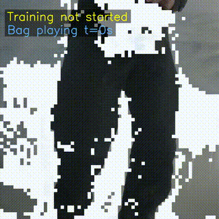
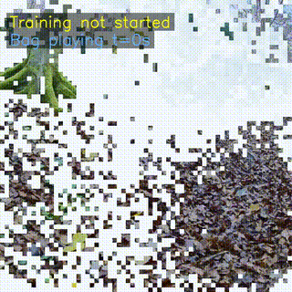
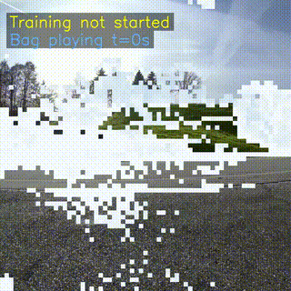
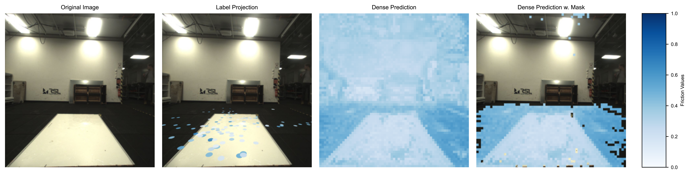
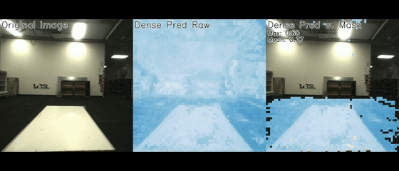
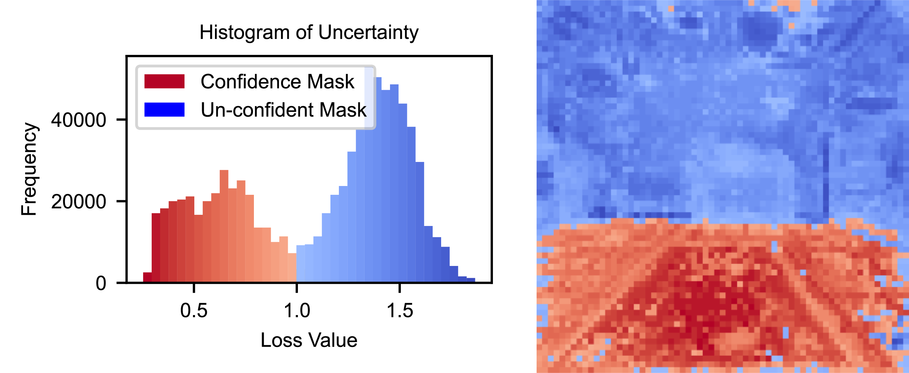
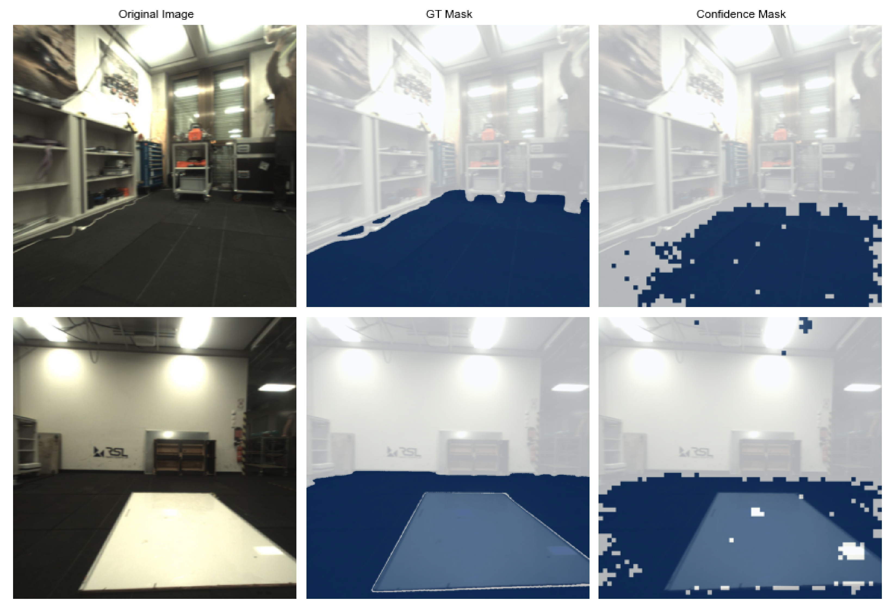

# 自监督视觉解码器学习

本模块用于在线训练视觉解码器，使其能够从图像预测由物理解码器估计的地形物理参数。该流程基于 [Fast Traversability Estimation for Wild Visual Navigation](https://github.com/leggedrobotics/wild_visual_navigation) 项目。

## 相较于论文版本的改进

1. **新的置信度掩码生成器（gmm_1d_history）**：保留一段足端接触区域的重建损失历史，将这些区域作为可信样本，以缓解切换到新场景时置信度掩码划分不稳定的问题。目前默认启用。
2. **新的视觉解码器（SeperateMLP）**：将特征重建与物理参数预测分成两个独立的 MLP，有助于稳定训练。目前默认启用。

## 与 [GrandTour 数据集](https://grand-tour.leggedrobotics.com/)的兼容性

本模块兼容 GrandTour 数据集。该数据集使用搭载 Boxi 的 ANYbotics ANYmal D 四足机器人采集；Boxi 是先进的全开源传感器载荷。请按照 [GrandTour 项目说明](https://github.com/leggedrobotics/grand_tour_dataset)安装和配置数据集。

下面展示了在 GrandTour 数据集上运行在线训练流程的三个示例。视频在在线训练过程中实时录制。在带掩码的稠密预测图中，蓝色越深表示预测的摩擦值越高：

<table align="center">
  <tr>
    <td align="center">
      <br />
      <b>ICE-1：在冰面行走／打滑</b><br />
      <i>低摩擦</i>
    </td>
    <td align="center">
      <br />
      <b>ALB-3：在森林中行走</b><br />
      <i>中高摩擦</i>
    </td>
    <td align="center">
      <br />
      <b>ARC-1：在工业场景中行走</b><br />
      <i>中高摩擦</i>
    </td>
  </tr>
</table>

## 使用说明

**功能特点：**

- 支持快速在线训练，能够适应新场景。
- 在线训练框架原则上不依赖特定机器人平台。
- 包含快速异常检测，用于过滤分布外（OOD）的预测。
- 默认不长期保留旧数据，适合长时间任务，内存开销不会随任务时长持续增长。

**注意事项：**

- 不同场景可能需要调整超参数，尤其是图管理参数。例如，与室外或变化较少的场景相比，室内或频繁变化的场景可能需要更小的图节点间距和更新范围。
- 足端接触区域的投影精度对学习效果至关重要。在狭小或杂乱的场景中，错误投影可能将物理参数标签关联到不对应的物体。
- 本模块提供多种异常检测方法，各有优势，可根据需求选择。

| 方法 | 优势 | 局限性 |
|---|---|---|
| **Gaussian/Fixed**（旧方法） | 在场景切换或相机短暂遮挡时较稳定，无需假设输入呈双峰分布 | 需要调参；偏向稳定性的设置可能收敛较慢，激进的设置可能更快但不稳定 |
| **GMM1D**（论文提出的方法） | 速度快，无需手动调整阈值；针对每次输入自适应确定阈值，适合在线训练 | 当输入明显不呈双峰分布时，性能会下降，例如场景切换或相机短暂遮挡时 |
| **GMM1D_History**（新增方法） | 速度快，通常只需少量调参，阈值自适应 | 在输入明显不呈双峰分布时，相比 GMM1D 性能下降较小 |

## 安装

**注意：**请按照下面的顺序安装，否则可能遇到依赖问题。以下示例使用 mamba 管理虚拟环境，Python 版本为 **3.9**。

### 1. 首先安装 RoboStack ROS

请参考 [RoboStack 入门说明](https://robostack.github.io/GettingStarted.html)。

随后安装 PlotJuggler：

```bash
mamba install ros-noetic-plotjuggler-ros
```

### 2. 安装 PyTorch

```bash
mamba install pytorch torchvision torchaudio pytorch-cuda=12.1 -c pytorch -c nvidia
```

### 3. 安装其他依赖

在本 README 所在的外层 `base_wvn/` 目录执行：

```bash
pip install -r requirements.txt
```

如果出现缺少依赖的错误，请根据报错信息补充安装。

**前置依赖：**

- 使用 pip 安装[独立预训练物理解码器](../physical_decoder/)。
- 安装 [liegroups](https://github.com/utiasSTARS/liegroups.git) 和 [Segment Anything](https://github.com/facebookresearch/segment-anything.git)。
- 将 [ros-comm](https://github.com/leggedrobotics/ros_comm) 放到 `src/` 目录，以避免实时运行时的 ROS 通信问题。
- 使用 `sudo apt install tmux` 安装 tmux。

在 `.bashrc` 中设置 Neptune API Token、用户名和项目名称：

```bash
export NEPTUNE_API_TOKEN="your_neptune_api_token"
export NEPTUNE_USERNAME="your_neptune_username"
export NEPTUNE_PROJECT="your_neptune_username/your_neptune_project_name"
```

### 4. 安装 base_wvn Python 包

```bash
pip install -e .
```

### 5. 可选：安装并构建 GrandTour ROS 包

先完成 GrandTour 项目的 [Git 配置步骤](https://github.com/leggedrobotics/grand_tour_dataset?tab=readme-ov-file#clone-and-link-submodules)，再执行：

```bash
# 如需避免叠加多个工作空间，可将 GrandTour ROS 包链接到当前工作空间
ln -s ~/git/grand_tour_dataset/examples_ros1 ~/physical_terrain_parameter_learning/base_wvn/src/

# 先构建 grand_tour_ros1 包
catkin init
catkin config --extend /opt/ros/noetic
catkin config --cmake-args -DCMAKE_BUILD_TYPE=RelWithDebInfo
catkin build grand_tour_ros1
source devel/setup.bash
```

以上路径是示例，请根据实际目录调整。

### 6. 构建 base_wvn ROS 包

```bash
catkin build wild_visual_navigation_ros
source devel/setup.bash

# 可选：如果使用 conda，且加载工作空间后找不到环境中的 Python，可恢复环境路径
export PATH="$CONDA_PREFIX/bin:$PATH"
```

## 通用配置

所有配置集中在 [base_wvn/config/wvn_cfg.py](base_wvn/config/wvn_cfg.py)。训练和测试前应检查路径相关设置。以下是重要参数：

1. `roscfg.phy_decoder_input_topic`：ANYmal D 物理解码器的预设输入话题，使用原配套数据时不要随意更改。
2. `roscfg.camera_topic`、`roscfg.camera_info_topic`：相机图像和内参话题。应使用朝向行走方向的相机。如果配置中没有该相机的坐标变换，需要自行计算，并更新 [ROS 节点脚本](src/wild_visual_navigation_ros/scripts)中的对应设置。
3. `roscfg.use_vo`：仅在具有指定的 `open3d_slam` 话题时设为 `True`；否则设为 `False`，使用默认的 ANYmal 状态话题获取位姿。
4. `general.pub_which_pred`：设为 `fric` 时，在 `/vd_pipeline/friction` 发布带掩码的稠密摩擦预测图；设为 `stiff` 时，在 `/vd_pipeline/stiffness` 发布刚度预测图。
5. `graph` 配置组：图管理参数可能需要按场景尺度调整，例如 `graph.edge_dist_thr_main_graph`。
6. `graph.label_ext_mode`：设为 `True` 时，记录在线采集的节点和训练批次，以供离线训练使用。
7. `offline.mode`：`train` 表示离线训练后评估，`eval` 表示仅评估。
8. `offline.env`：环境名称，必须与数据所在文件夹名称一致。例如，数据目录为 `base_wvn/results/manager/train/forest` 时，应设置为 `forest`。
9. `offline.replicate_online_training`：设为 `True` 时，按照在线记录的样本顺序进行离线训练；否则从记录的节点生成样本并随机采样训练。
10. `offline.test_on_images`、`offline.test_on_nodes`：分别控制图片测试和已记录节点测试。可结合 `offline.plot_hist`、`offline.plot_nodes`、`offline.plot_masks_compare` 设置生成相应可视化，示例见下文。
11. `offline.test_video`：设为 `True` 时，从 `offline.img_bag_path` 指定的 rosbag 中读取配置的相机图像话题，生成预测视频。

## 在线训练

### 运行

具体设置请参考代码和配置文件。以下命令从外层 `base_wvn/` 目录执行：

```bash
# 启动全部 base_wvn 核心节点
./src/wild_visual_navigation_ros/scripts/play_base_wvn.sh

# 可选方式1：回放 rosbag，在回放过程中进行在线训练
# 运行前需将 scripts/play_rosbags.sh 中的数据路径改为实际路径
roslaunch wild_visual_navigation_ros play.launch

# 可选方式2：使用 GrandTour 的 rosbag 回放流程
roslaunch grand_tour_ros1 lidars.launch

# 先进入包含 bag 文件的目录，再执行
rosrun grand_tour_ros1 rosbag_play.sh *.bag
```

如果使用 GrandTour 数据集，可下载项目提供的 [lidars.rviz 配置](https://drive.google.com/file/d/1-iGgFD2KczRin03ITAk0-yzYVLS3yDb_/view?usp=drive_link)，替换 GrandTour 目录中的 `~/git/grand_tour_dataset/examples_ros1/grand_tour_ros1/cfg/lidars.rviz`，以显示本流程的相关话题。

### tmux 操作

先按 `Ctrl+B`，再按方向键切换终端面板；在对应面板按 `Ctrl+C` 停止程序。

关闭整个 tmux 会话时，先按前缀键（默认 `Ctrl+B`，若自行配置也可能是 `Ctrl+A`），再按 `:`，输入 `kill-session` 并回车。

## 离线训练

下载 [Segment Anything 模型检查点](https://drive.google.com/file/d/1m7-1JiITaYPDEOrq1YrQPlHtTCxwFbc9/view?usp=drive_link)，并在配置文件中填写对应路径。

### 采集离线数据集

离线数据通过在线 rosbag 回放流程生成。设置 `graph.label_ext_mode=True` 后即可记录数据，相关参数和保存路径在配置文件中设置。请将 `play_base_wvn.sh` 中的路径改为实际路径；也可使用 GrandTour 的回放流程。

```bash
# 启动全部 base_wvn 核心节点
./src/wild_visual_navigation_ros/scripts/play_base_wvn.sh

# 开始回放 rosbag，也可改用 GrandTour 的回放方式
roslaunch wild_visual_navigation_ros play.launch

# 按下文的 tmux 操作方式，用 Ctrl+C 正常停止记录
```

### 停止记录

在 tmux **最左侧面板**按 `Ctrl+C`，可结束记录并触发保存。

### 数据集目录结构

原示例的保存位置为 `~/base_wvn/results/manager`；实际位置由配置和启动目录决定。记录后包含：

- `train_data.pt`：保存在线训练使用的特征与标签数据对。
- `train_nodes.pt`：保存全部有效主节点及其信息。

首次运行离线训练时，还会生成：

- `gt_masks_SAM.pt`：SAM 自动生成的参考掩码（用于 GT 对比）。
- `mask_img.pt`：上述掩码对应的彩色图像。

需要按 `train` 或 `val`，再按环境名称组织数据。例如：`~/base_wvn/results/manager/train/forest`。环境名称应与配置中的 `offline.env` 一致。

### 人工修正参考掩码

SAM 自动生成的掩码并不总是准确，可使用 segments.ai 进行人工修正。

可通过 `base_wvn/offline/seg_correction.py` 处理和替换修正后的掩码，具体用法请参考该文件。

### 运行

切换配置中的训练或评估模式后，在外层 `base_wvn/` 目录执行：

```bash
python base_wvn/offline/train_eval.py
```

### 离线可视化示例

1. 设置 `param.offline.plot_nodes=True`，显示已记录节点图像上的稠密预测：

<p align="center">
    
</p>

2. 设置 `offline.test_video=True`，从 `offline.img_bag_path` 指定的 rosbag 生成预测视频：

<p align="center">
    
</p>

3. 设置 `param.offline.plot_hist=True`，显示重建损失与置信度相关可视化：

<p align="center">
    
</p>

4. 设置 `param.offline.plot_masks_compare=True`，对比预测置信度掩码与参考掩码：

<p align="center">
    
</p>

## 致谢

本流程使用了以下采用 MIT 许可证的开源项目代码：

- [wild_visual_navigation](https://github.com/leggedrobotics/wild_visual_navigation)，作者为 Matias Mattamala、Jonas Frey。
