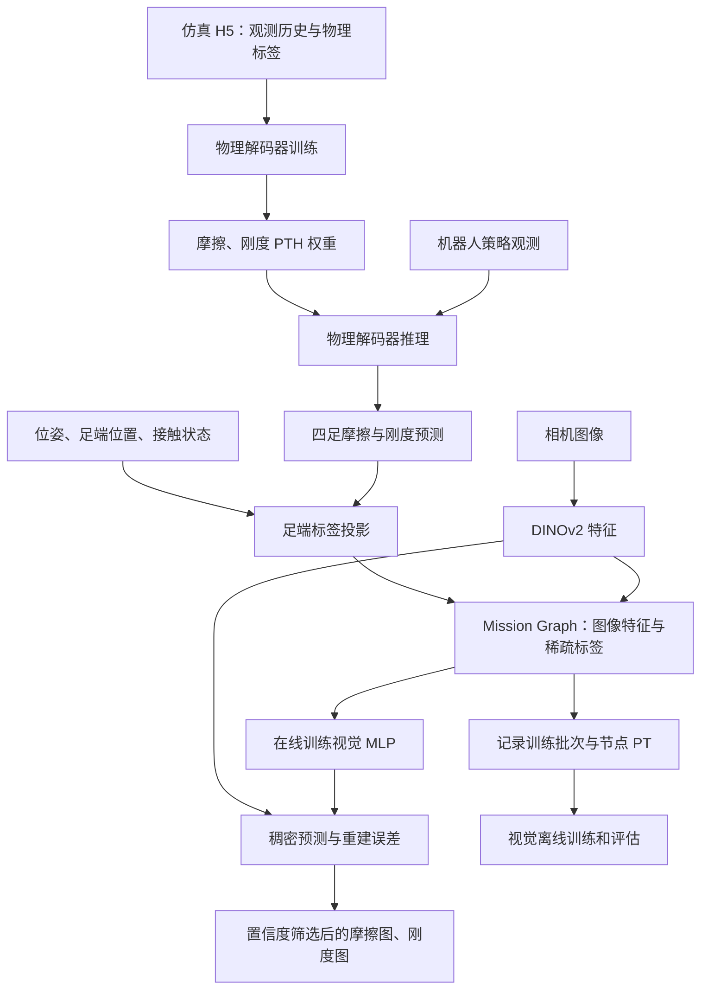

# Physical Terrain Parameter Learning：项目逻辑与运行方式

本文依据当前仓库源代码整理，重点覆盖运行入口、数据流、配置和重要文件。文中的命令是环境与数据准备完成后的启动方式，并不代表已经完成端到端运行验证。本文不记录个人问答、账号或机器环境。

## 1. 项目解决的问题

项目分成两个学习阶段：

1. **物理解码器**：从机器人观测历史估计每只脚对应的摩擦和刚度。使用带标签的仿真数据训练，部署时使用预训练权重。
2. **视觉解码器**：将足端物理预测投影到相机图像，作为稀疏监督；在线学习图像特征与物理参数的关系，输出带置信度掩码的稠密预测。

输出应理解为与仿真参数对应的估计，不应直接当作经过标定的真实材料物理测量值。当前提供的物理解码器面向 ANYmal D 及其特定观测布局。



这里的 graph 是用于保存、选择和关联历史观测的数据结构，不是图神经网络。

## 2. 三个目录及其关系

| 目录 | 核心用途 | 是否为主要运行入口 |
|---|---|---|
| `physical_decoder/` | 物理模型定义、共享模型配置、预训练权重和部署接口 | 主要通过 Python API 调用 |
| `physical_decoder_training/` | 使用 H5 数据训练和评估物理解码器 | `train_eval.py` |
| `base_wvn/` | 视觉学习、ROS 在线流程、数据记录与视觉离线实验 | 三个 ROS 节点与 `offline/train_eval.py` |
| `.docs/` | README 使用的框架图、结果图和演示动图 | 否 |

`base_wvn/base_wvn/` 是 Python 包；`base_wvn/src/` 是 ROS 包。外层 `base_wvn/` 同时承担 ROS 工作空间和视觉项目根目录的角色。

### 根目录其他文件

| 文件 | 用途 |
|---|---|
| `README.md` | 总体说明、物理解码器安装和训练方法、数据下载入口 |
| `LICENSE` | 项目许可证 |
| `Identifying_Terrain_Physical_Parameters_From_Vision_-_Towards_Physical-Parameter-Aware_Locomotion_and_Navigation.pdf` | 本地论文材料，不参与运行 |
| `AGENTS.md` | 协作约束，不参与算法运行 |
| `.gitignore`（若存在） | Git 忽略规则，不影响模型行为 |
| `.git/`、`.agents/`、`.codex/`（若存在） | 版本或工具管理目录，不是项目训练数据和模型入口 |

## 3. 物理解码器：physical_decoder/

### 3.1 文件职责

| 文件（相对本目录） | 用途 | 运行关注点 |
|---|---|---|
| `requirements.txt` | 独立部署依赖 | 与训练模块的版本要求并不完全一致 |
| `setup.py` | 安装 `physical_decoder` Python 包 | 通常使用 editable 安装 |
| `physical_decoder/__init__.py` | 导出模型工厂、配置、部署接口和查找工具 | 支持 `from physical_decoder import DeploymentWrapper` |
| `physical_decoder/decoder_config.py` | 定义原始输入分区和 `ModelParams` | **物理训练和部署共同使用的模型配置** |
| `physical_decoder/decoder.py` | `ModelFactory`、`Base`、`Parallel`、`Mlp`、时序注意力及输入切片 | 核心网络实现 |
| `physical_decoder/deployment_wrapper.py` | 自动加载两种权重，维护输入历史，提取当前预测 | **部署调用入口** |
| `physical_decoder/utils.py` | 按配置构造权重匹配模式、选择匹配文件 | 配置变化可能导致找不到权重 |
| `physical_decoder/modules/mlp.py` | 物理模型预测头和门控头使用的 MLP | 网络基础组件 |
| `physical_decoder/modules/normalizer.py` | 标签统计归一化及预测反归一化 | 归一化状态随模型保存 |
| `physical_decoder/modules/__init__.py` | 导出基础模块 | 包组织 |
| `physical_decoder/models/model_fric_parallel_pro+exte_2025_06_29_1902.pth` | 已提供的摩擦预测权重 | 默认 parallel、pro+exte 架构 |
| `physical_decoder/models/model_stiff_parallel_pro+exte_2025_06_30_1652.pth` | 已提供的刚度预测权重 | 与摩擦模型分别加载 |

### 3.2 输入输出与网络逻辑

原始观测的分区由 `RawInputParams` 定义：

| 分区 | 切片 | 维度 | 含义 |
|---|---|---:|---|
| `pro` | `[0:133]` | 133 | 策略使用的本体感知等观测 |
| `exte` | `[133:341]` | 208 | 地形几何观测 |
| `hidden` | `[341:441]` | 100 | 可选策略隐藏状态 |

输入选项包括 `pro`、`pro+exte`、`all`、`all-e`；其中 `all-e` 为 `pro+hidden`。默认 `pro+exte` 实际选用341维。接口接收保持原始布局的观测，不能任意重排字段。

默认配置：历史长度50、单层 GRU、隐藏维度100、每个模型输出4维、设备为 CUDA。

`Parallel` 内部有两条路径：融合输入路径和仅本体感知路径。两条路径分别经过 GRU、时序自注意力和 MLP；融合路径还产生 sigmoid 门控。实际组合为：

```text
最终预测 = 融合路径预测 + 门控 × 本体感知路径预测
```

这不是两个分支权重之和固定为1的加权平均。摩擦和刚度分别拥有独立模型。

训练输入形状为 `[B, T, F]`，输出为 `[B, T, 4]`。部署接口接收 `[B, F]`，内部维护长度50的滑动窗口，返回两个 `[B, 4]` 张量。启动时历史缓冲区以零填充，随后逐步被真实观测替代。历史窗口长度不能直接等同于固定推理延迟。

独立 `DeploymentWrapper` 不裁剪输出范围；ROS 物理解码节点才将摩擦裁剪到 `[0,1]`、刚度裁剪到 `[1,10]`。

## 4. 物理训练：physical_decoder_training/

| 文件 | 用途 | 运行关注点 |
|---|---|---|
| `requirements.txt` | 训练依赖，包括 PyTorch、Lightning、Deepdish、Neptune | 包含固定版本 |
| `train_eval.py` | 构建数据管理器，训练、保存并评估模型 | **训练/评估总入口** |
| `training_utils/run_config.py` | 模式、epoch、batch、数据路径、权重目录、日志参数 | **实验配置入口** |
| `training_utils/data_manager.py` | 筛选 H5、合并数据、按 episode 切序列、构造 DataLoader、统计标签权重 | **数据加载核心** |
| `training_utils/lightning_wrapper.py` | Lightning 训练/验证步骤和 Adam 优化器 | 将模型及损失接入 Trainer |
| `training_utils/loss_wrapper.py` | 模型初始化、标签归一化、标签加权、MSE 与 L1 损失 | 默认 `MSE + 0.2 × L1`，两项均可加权 |
| `training_utils/utils.py` | 保存权重、批量与单环境评估、分箱指标、误差图和日志 | 训练后的输出与评价 |
| `training_utils/dataset_analysis.py` | 时间戳解析、episode统计与独立数据分析示例 | 独立示例含需修改的目录和环境编号 |
| `training_utils/__init__.py` | Python 包标记 | 不单独启动 |

### 4.1 数据加载逻辑

```text
数据目录
 → 按文件名 rigidRatio 和 output_type 筛选 H5
 → Deepdish 加载并合并环境数据
 → counter 变化划分 episode
 → 每个 episode 内截取定长序列
 → 组合输入及标签
 → RNNDataset / DataLoader
 → Lightning 训练或评估
```

- 路径参数接收目录，不是单个 H5 文件名。
- 摩擦训练选择 `rigidRatio ∈ [0.8,1.0]`；刚度训练选择 `[0.0,0.2]`。
- 数据加载器期望环境编号下包含 `counter`、`policy`、`priv_exte`、`hidden`、`fric`、`stiff` 等字段。
- 输入按 `policy + priv_exte + hidden` 拼接；摩擦取4足标签，刚度从原始字段的第8、17、26、35列提取。
- 默认序列长度50；参数名 `overlapp=25` 在实现里实际作为窗口步长。
- 序列不会跨 episode 边界；不足一整段的尾部被舍弃。
- `val_test_env_id` 必须存在于验证数据中。
- 数据集整理时会将张量放到模型设备；显存占用不只取决于 batch size。

### 4.2 训练入口行为

`general.mode="train"` 会先训练，再执行评估；`"eval"` 跳过训练，但仍要加载验证数据与已有权重。摩擦与刚度需要分别运行。

`continue_training=True` 加载匹配模型参数后继续训练，不是完整恢复 Lightning 的优化器和 epoch 状态。

训练和评估均创建或使用 Neptune 日志对象。当前入口没有关闭 Neptune 的配置开关。

训练保存函数将权重写到**当前工作目录的 `models/`**；加载时使用 `general.model_directory`。如果修改后者，需要同时核对保存位置，不能假设两者自动同步。部署则从 Python 包内部的 `physical_decoder/models/` 查找权重，新训练结果不会自动替换部署权重。

## 5. 视觉与 ROS：base_wvn/

### 5.1 外层安装与配置文件

| 文件 | 用途 |
|---|---|
| `README.md` | ROS安装、在线运行、离线记录与评估说明 |
| `requirements.txt` | 视觉特征、图像处理、训练、可视化等依赖；多数未锁版本 |
| `setup.py` | 安装 `base_wvn` Python 包 |
| `base_wvn/__init__.py` | 导出配置并定义 `WVN_ROOT_DIR`，指向外层 `base_wvn/` |
| `base_wvn/config/wvn_cfg.py` | **视觉、ROS、图管理、损失与离线实验统一配置** |
| 各子目录的 `__init__.py` | 包标记或公共对象导出，不是业务启动入口 |

主要配置组：

| 配置组 | 管理内容 |
|---|---|
| `general` | 在线训练开关、恢复权重、保存目录、发布摩擦或刚度 |
| `roscfg` | 话题、坐标系、相机外参、足端名称及尺寸 |
| `thread` | 相机、监督信号、学习和日志处理频率上限 |
| `run` | 设备、随机种子和调试模式 |
| `feat` | DINOv2、输入缩放与裁剪、物理输出维度 |
| `graph` | 节点数量、距离阈值、投影范围、抽样数量、记录模式 |
| `model` | 视觉 MLP 类型和网络大小 |
| `loss` | 重建/物理回归损失权重及置信度算法 |
| `optimizer` | 视觉优化器参数 |
| `offline` | 离线数据、模式、检查点来源、SAM及图片/节点/视频测试选项 |

`thread.learning_rate` 表示学习线程运行频率，优化器学习率是 `optimizer.lr`。

### 5.2 model/：视觉网络

| 文件 | 用途 |
|---|---|
| `base_wvn/model/mlp.py` | 定义 `SimpleMLP` 和默认的 `SeperateMLP`；后者将特征重建与物理回归分为独立网络 |
| `base_wvn/model/network_register.py` | 根据配置名称构建视觉模型 |
| `base_wvn/model/dataset.py` | `VD_dataset`：组织、抽样和合并视觉特征与物理标签批次 |

默认 DINOv2 特征为384维；视觉模型输出384维重建特征以及2维摩擦/刚度。训练目标默认是 `0.9 × 重建损失 + 0.1 × 物理回归损失`。刚度在损失计算中除以10，与摩擦尺度对齐。

### 5.3 graph_manager/：历史数据与在线训练

| 文件 | 用途 |
|---|---|
| `base_wvn/graph_manager/nodes.py` | `MainNode` 保存图像、特征、相机位姿与监督掩码；`SubNode` 保存足端接触区域及物理标签；`BaseNode` 提供公共信息 |
| `base_wvn/graph_manager/graphs.py` | 节点插入、距离查询和抽样；提供数量、时间或距离窗口等图结构 |
| `base_wvn/graph_manager/manager.py` | **在线算法调度核心**：节点管理、足端投影、训练批次、模型更新、置信度更新、数据及检查点保存 |

默认主图保留最多40个节点；新节点距离阈值为1m，足端向主节点投影的搜索范围为5m。具体值应按场景调整。`use_sub_graph=False` 不意味着没有足端监督，只是不额外保留完整的子图历史。

`label_ext_mode=True` 时保留全部主图节点，并记录训练时采样的批次；此模式不再使用默认40节点的内存限制。关闭程序时保存 `train_data.pt` 和 `train_nodes.pt`。

### 5.4 utils/：感知与监督工具

| 文件 | 用途 |
|---|---|
| `base_wvn/utils/dinov2_interface.py` | 使用 `torch.hub` 加载 DINOv2，归一化图像并提取 patch 特征；默认 `dinov2_vits14_reg` |
| `base_wvn/utils/feat_extractor.py` | 图像缩放、裁剪、特征提取封装；提供内参修正需要的比例和偏移 |
| `base_wvn/utils/image_projector.py` | 根据相机内参和位姿将三维足端区域投影、渲染到图像 |
| `base_wvn/utils/meshes.py` | 构造椭圆、平面等几何区域；在线监督使用足端接触区域 |
| `base_wvn/utils/foot_contact_filter.py` | 结合足端运动与接触输入过滤接触状态 |
| `base_wvn/utils/loss.py` | `PhyLoss`：特征重建、物理参数回归与尺度归一化 |
| `base_wvn/utils/confidence_mask_generator.py` | 固定统计阈值、GMM、带历史GMM，生成可信区域及预测叠加结果 |
| `base_wvn/utils/visualizer.py` | 图像叠加、色条、图像拼接和保存 |

DINOv2 以无梯度方式提取特征，在线主要优化轻量视觉 MLP。默认置信度方法为 `gmm_1d_history`：结合当前图像重建误差和已监督样本的历史重建误差拟合 GMM，选取低误差簇作为可信区域。置信度反映特征分布相似性，不是物理误差的严格概率保证。

### 5.5 src/wild_visual_navigation_ros/：ROS 封装

| 文件 | 用途 |
|---|---|
| `package.xml` | ROS 包元信息与声明依赖 |
| `CMakeLists.txt` | catkin 构建与三个 Python 节点安装 |
| `setup.py` | ROS Python 包安装配置 |
| `scripts/physical_decoder_node.py` | **节点1**：策略观测 → 两个物理解码器 → 裁剪后的四足预测 |
| `scripts/supervision_label_builder_node.py` | **节点2**：同步物理预测和状态，加入位姿、足端区域和接触信息 |
| `scripts/main_process_node.py` | **节点3**：图像/监督回调、DINOv2、图管理、学习线程、结果发布与退出保存 |
| `scripts/ros_node.py` | 三个节点公共基类：读取配置、选择相机外参、坐标变换与退出处理 |
| `scripts/ros_converter.py` | ROS消息与 NumPy/Torch、图像、SE(3)、相机内参之间的转换 |
| `scripts/play_base_wvn.sh` | 用 tmux 启动三个核心节点；Python、脚本、工作空间路径写死，需要适配 |
| `scripts/play_rosbags.sh` | 切换数据目录并执行带时钟的 bag 回放；目录写死，需要适配 |
| `launch/play.launch` | 启动 bag 播放脚本、RViz和 `anymal_d` 配置节点；**不启动三个核心算法节点** |
| `launch/play.rviz`、`launch/frame.rviz` | RViz显示配置，不执行训练 |
| `launch/plotjuggler.xml` | PlotJuggler曲线显示配置 |

主要话题链：

```text
/anymal/locomotion_policy/debug_info
 → physical_decoder_node
 → /phy_decoder/temp_out
 → supervision_label_builder_node + /anymal/state_estimator/anymal_state
 → /vd_pipeline/phy_decoder_out
 → main_process_node + 图像/CameraInfo/位姿
 → /vd_pipeline/friction 或 /vd_pipeline/stiffness
```

默认相机为 `/boxi/hdr/front/image_raw/compressed`，相机内参为 `/boxi/hdr/front/camera_info`。视觉里程计仅在 `use_vo=True` 时加入。相机话题变化时还需核对 `ros_node.py` 的外参选择分支与实际消息类型。

### 5.6 src/wild_visual_navigation_msgs/：消息定义

| 文件 | 用途 |
|---|---|
| `package.xml`、`CMakeLists.txt` | 声明消息依赖并生成消息、服务类型 |
| `msg/PhyDecoderOutput.msg` | 物理预测及监督信息：时间戳、机身位姿、8个预测值、足端位姿/接触/区域 |
| `msg/PlaneEdge.msg` | 命名的足端区域边界点 |
| `msg/ChannelInfo.msg` | 输出图像通道说明 |
| `msg/AnymalState.msg` | ANYmal机器人状态接口 |
| `msg/Contact.msg` | 接触信息接口 |
| `msg/ExtendedJointState.msg` | 扩展关节状态接口 |
| `srv/SaveCheckpoint.srv`、`srv/LoadCheckpoint.srv` | 检查点保存/加载的服务类型定义；当前脚本中未找到对应 `rospy.Service` 注册，不能仅凭类型文件认为服务已运行 |

### 5.7 offline/：视觉离线实验

| 文件 | 用途 |
|---|---|
| `base_wvn/offline/train_eval.py` | **视觉离线总入口**：训练、权重加载、图片预测、节点评估和视频生成 |
| `base_wvn/offline/dataset_cls.py` | 从记录批次或节点生成 DataLoader；控制顺序重放与随机抽样 |
| `base_wvn/offline/lightening_module.py` | `DecoderLightning` 训练封装，以及节点误差/置信度掩码评估器；文件名确实为 `lightening_module.py` |
| `base_wvn/offline/helper.py` | 加载图片/检查点、SAM参考掩码、节点数据集、物理误差、重建误差图与掩码IoU等辅助函数 |
| `base_wvn/offline/pred_video_producer.py` | 读取 bag 图像，生成原图、原始预测、带掩码预测的拼接视频 |
| `base_wvn/offline/seg_correction.py` | 对SAM参考掩码进行人工修正的辅助工具，包含外部标注结果替换和集合操作 |

SAM用于离线参考掩码和评价，不是在线物理监督标签的来源。

## 6. 项目提供的运行方式

从主要入口看有三类：物理模型API、物理训练/评估、视觉ROS/离线流程。按用户目的可细分为下面八种；其中记录、图片和视频模式是已有入口的配置分支。

| 方式 | 入口 | 必要数据 | 主要输出 |
|---|---|---|---|
| A. 独立物理解码器推理 | `DeploymentWrapper.predict()` | 按原布局组织的逐帧观测、两套物理权重 | 每只脚摩擦与刚度 |
| B. 物理解码器训练后评估 | `physical_decoder_training/train_eval.py` | 对应参数类别的训练/验证H5 | PTH、参数文件、评估结果 |
| C. 物理解码器仅评估 | 同上，`general.mode="eval"` | 验证H5和匹配权重 | 单环境曲线与批量指标 |
| D. ROS在线视觉学习 | 三个ROS节点 | 实时话题或完整bag、物理权重、DINOv2 | 稠密预测话题、视觉检查点 |
| E. 在线记录视觉离线数据 | D + `graph.label_ext_mode=True` | 同D | `train_data.pt`、`train_nodes.pt` |
| F. 视觉离线训练后评估 | `base_wvn/offline/train_eval.py` | 记录的PT、参考掩码或SAM资源 | 视觉检查点、指标和可视化 |
| G. 视觉离线图片/节点评估 | 同上，`offline.mode="eval"` | 视觉检查点、图片/节点及初始化依赖 | 预测图、节点误差或掩码指标 |
| H. 视觉预测视频生成 | 同上 + `offline.test_video=True` | 视觉检查点、图像bag及初始化依赖 | 拼接预测视频 |

### A. 独立推理

安装好 `physical_decoder` 后，在自己的Python程序里调用：

```python
from physical_decoder import DeploymentWrapper

decoder = DeploymentWrapper()
# observation: 实际机器人逐帧观测张量 [B, F]，保持原始字段布局
friction, stiffness = decoder.predict(observation)
```

不需要H5、ROS、Neptune或DINOv2。随机输入只能检查接口形状，不能验证物理预测准确性。

### B / C. 物理训练与评估

建议从仓库根目录执行，统一相对输出路径：

```bash
cd /home/ubuntu/桌面/physical_terrain_parameter_learning-master
python physical_decoder_training/train_eval.py
```

运行前配置 `training_utils/run_config.py` 的模式、训练/验证目录、epoch、batch和日志；配置 `decoder_config.py` 的输入类型、输出类别、模型结构和设备。训练设 `mode="train"`，仅评估设 `mode="eval"`。

成功标准：数据成功分段、产生训练/验证指标、训练模式生成可重新加载的PTH。训练验证使用同一数据只适合流程检查，不是独立泛化评价。

### D. ROS在线学习：真实数据与bag回放

实时机器人话题和bag回放使用相同算法节点；回放只是数据来源不同。当前节点入口设置了 `/use_sim_time=True`，现成脚本偏向bag回放。连接真实机器人时需检查时钟配置，不能无条件照搬。

完成ROS构建和Python安装后，每个终端加载同一ROS基础环境与本项目的 `base_wvn/devel/setup.bash`。统一从外层 `base_wvn/` 启动，有助于保持相对路径一致。

```bash
# 不同终端分别执行；roscore只需一个
roscore
rosrun wild_visual_navigation_ros physical_decoder_node.py
rosrun wild_visual_navigation_ros supervision_label_builder_node.py
rosrun wild_visual_navigation_ros main_process_node.py
rosbag play --clock /实际数据路径/数据.bag
```

另一种启动方式是先修改 `play_base_wvn.sh` 中的绝对路径，再用它统一启动三个节点。`play.launch` 是额外的回放和显示入口，含作者绝对路径及 `anymal_d` 依赖，不能当作通用的一键运行文件。

成功标准：物理预测话题有数据、足端投影出现有效监督像素、视觉训练步数增长、所选稠密预测话题持续发布。只有节点启动或看到图像，不足以证明在线训练已经发生。

若要在线仅推理，需加载已训练视觉检查点，并关闭 `general.online_training`；三个节点的现有依赖和等待话题行为仍需满足，这不是独立的纯图像推理入口。

### E. 在线记录

设置 `graph.label_ext_mode=True` 后运行在线流程，通过正常退出触发保存。训练批次是在 `Manager.train()` 中记录的，因此若关闭学习，不能假定仍能得到有效的 `train_data.pt`。

默认保存目录配置为 `results/manager`，退出时得到 `train_data.pt` 与 `train_nodes.pt`。离线实验前需要自行组织为：

```text
base_wvn/results/manager/
├── train/<env>/
│   ├── train_data.pt
│   ├── train_nodes.pt
│   ├── gt_masks_SAM.pt   # 评估用缓存，可在首次生成
│   └── mask_img.pt       # 参考掩码对应图像
└── val/<env>/
    └── train_nodes.pt
```

`<env>` 与 `offline.env` 一致。代码在找不到验证节点文件时会回退到训练节点；这种回退不构成独立验证集。

### F / G / H. 视觉离线入口

从外层 `base_wvn/` 执行：

```bash
cd /home/ubuntu/桌面/physical_terrain_parameter_learning-master/base_wvn
python -m base_wvn.offline.train_eval
```

配置均在 `wvn_cfg.py`：

| 目的 | 配置 |
|---|---|
| 训练后评估 | `offline.mode="train"` |
| 只加载模型评估 | `offline.mode="eval"` |
| 按记录顺序训练 | `offline.replicate_online_training=True`，读取 `train_data.pt`，不打乱 |
| 从节点重新生成样本 | 上项设False，读取 `train_nodes.pt`，打乱训练样本 |
| 图片预测 | `offline.test_on_images=True` |
| 节点评估 | `offline.test_on_nodes=True` |
| 视频生成 | `offline.test_video=True`，配置 `img_bag_path`、相机话题 |
| 使用在线检查点 | `offline.use_online_ckpt=True`，配置 `general.resume_training_path` |
| 从旧检查点继续离线训练 | `offline.reload_model=True`，配合检查点来源选项 |

“复现在线训练”在这里表示保留记录样本顺序，不保证完整重现在线线程调度和随机状态。三个测试开关默认为False；仅设置 `mode="eval"` 不会自动生成所有结果。节点评估分支直接返回，因此同时开启节点评估与视频时，后面的视频分支不会执行。

当前离线入口存在额外初始化依赖：`DecoderLightning` 无条件创建 `MaskedPredErrorComputer`，后者读取训练节点和SAM掩码缓存，缓存缺失时调用SAM。因此即使只设置图片或视频预测，现有入口仍需要节点与参考掩码资源。模块顶层还导入视频及ROS转换代码，不能认为“离线图片模式不需要任何ROS Python依赖”。

离线训练的Trainer显式指定GPU；只修改 `run.device="cpu"` 不足以完整切换这一训练入口。视频的 `process_option` 实际接受 `all`、`first_half`、`first_1000`，以实现为准。

## 7. 数据与产物不能混用

| 文件/数据 | 生产方 | 消费方 | 含义 |
|---|---|---|---|
| 仿真 `.h5` | 外部仿真数据采集 | 物理训练/评估 | 观测历史及物理真值 |
| 物理 `.pth` | 物理训练或仓库提供 | 物理部署 | 摩擦或刚度模型参数 |
| 完整 ROS bag | 机器人数据记录 | ROS在线流程 | 图像、状态、策略观测等消息 |
| `train_data.pt` | 在线记录 | 视觉离线顺序训练 | 已抽样的特征与物理弱标签 |
| `train_nodes.pt` | 在线记录 | 视觉离线训练/评估 | 图像节点、特征、位姿、投影监督等 |
| `gt_masks_SAM.pt` | SAM与人工修正 | 视觉离线评价 | 参考区域掩码，不是摩擦真值文件 |
| `last_checkpoint.pt` | 视觉在线/离线训练 | 视觉恢复或评估 | 视觉模型、损失/置信度状态等；在线版本还保存优化器状态 |

物理 `.pth` 和视觉 `last_checkpoint.pt` 不能互换。包内预训练物理模型也不等于已经有适合当前场景的视觉模型。

### 7.1 H5与PT：如何选择下载和运行入口

`.h5` 是HDF5容器格式；本项目通过Deepdish读取其中的仿真观测与标签，用于训练或评估物理解码器。文件名中的 `rigidRatio` 决定当前加载器将其归入摩擦还是刚度训练数据。它不包含运行视觉在线流程所需的完整ROS消息流，不能直接交给视觉离线入口。

`.pt` 通常是本项目通过 `torch.save` 保存的对象。后缀本身不说明内容，更不意味着一定是模型权重：

- `train_data.pt`：视觉模型的训练样本，核心为DINOv2特征与摩擦/刚度弱标签；适合重放已记录的训练样本。
- `train_nodes.pt`：更完整的视觉节点数据，包含图像、特征、位姿和监督信息等；用于重新组织训练样本及节点评估。
- `gt_masks_SAM.pt`、`mask_img.pt`：离线掩码评价的参考区域和对应图像。
- `last_checkpoint.pt`：已经训练的视觉模型及相关状态，用于恢复训练或预测。

因此，只有H5时可以先进行物理训练/评估，不必先下载视觉PT。若要运行仓库现成的视觉离线流程，需要相应PT节点/样本文件，以及参考掩码或SAM资源；仅预测还需要视觉检查点。也可以从完整ROS数据运行在线流程并自行记录PT。外部下载目录中其他名称的PT，必须查看配套说明或实际内容后才能确定用途，不能仅凭扩展名归类。

## 8. 运行前重点核对

1. **先选择阶段**：H5用于物理训练，ROS消息用于在线视觉学习，记录PT用于视觉离线实验。
2. **核对环境**：文档示例使用Python 3.9；固定旧依赖与新版Python/PyTorch的兼容性需要验证。两个requirements中NumPy要求不同，不要机械叠加安装。
3. **核对模型配置**：物理配置同时影响训练与部署，架构或输入类型更改后必须匹配权重。
4. **核对日志**：物理训练/评估和视觉离线训练显式使用Neptune；ROS在线训练由Manager直接优化，不应与这些入口的日志要求混淆。
5. **核对外部资源**：DINOv2首次加载需下载或缓存；SAM离线评价需检查点或已有掩码缓存；ROS还需对应消息依赖，例如物理输入使用的 `signal_logger_msgs`。
6. **核对几何与时钟**：相机内参、外参、图像类型、足端顺序、坐标系和时间同步决定监督标签是否正确。
7. **核对路径基准**：物理训练建议从仓库根目录启动，视觉建议从外层 `base_wvn/` 启动；源码存在相对工作目录与 `WVN_ROOT_DIR` 两种路径方式。
8. **核对工作空间**：原WVN与本项目包含同名ROS包，使用 `rospack find` 确认实际加载的是本项目；容器内还要确认数据挂载路径。

## 9. 推荐源码阅读顺序

- 物理推理：`decoder_config.py` → `deployment_wrapper.py` → `decoder.py`。
- 物理训练：`train_eval.py` → `run_config.py` → `data_manager.py` → `lightning_wrapper.py` → `loss_wrapper.py`。
- 在线视觉：`wvn_cfg.py` → 三个ROS节点 → `manager.py` → `nodes.py` → 视觉 `mlp.py` → `loss.py` → `confidence_mask_generator.py`。
- 离线视觉：`offline/train_eval.py` → `dataset_cls.py` → `lightening_module.py` → `helper.py` / `pred_video_producer.py`。

参考：仓库根目录 `README.md`、`base_wvn/README.md` 以及以上列出的实际源码。文档仅新增说明，不改变项目的模型、配置或启动行为。
